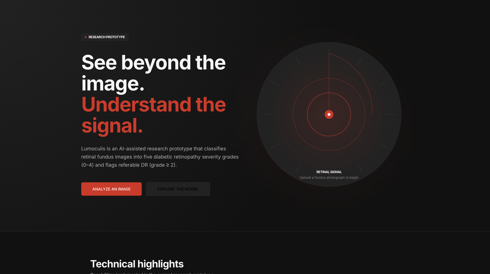
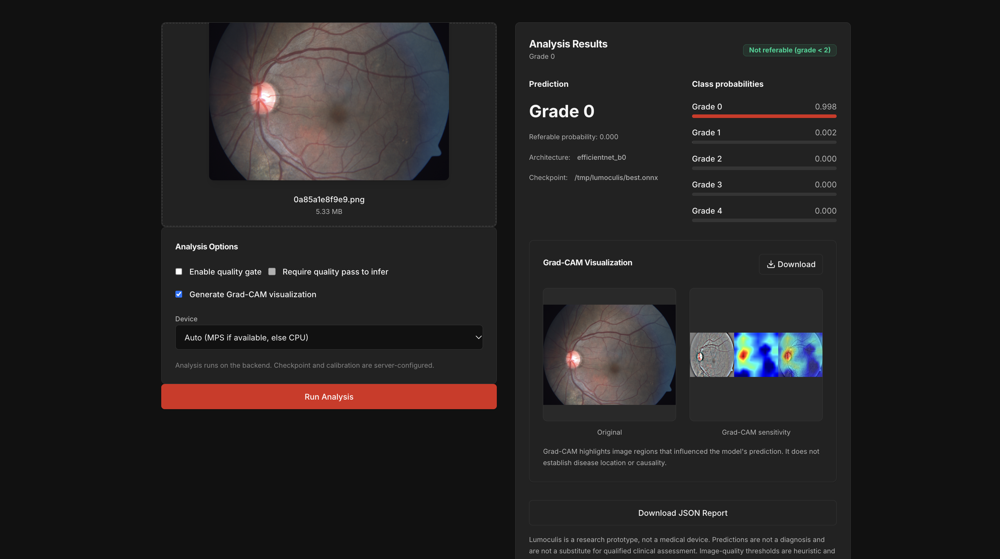
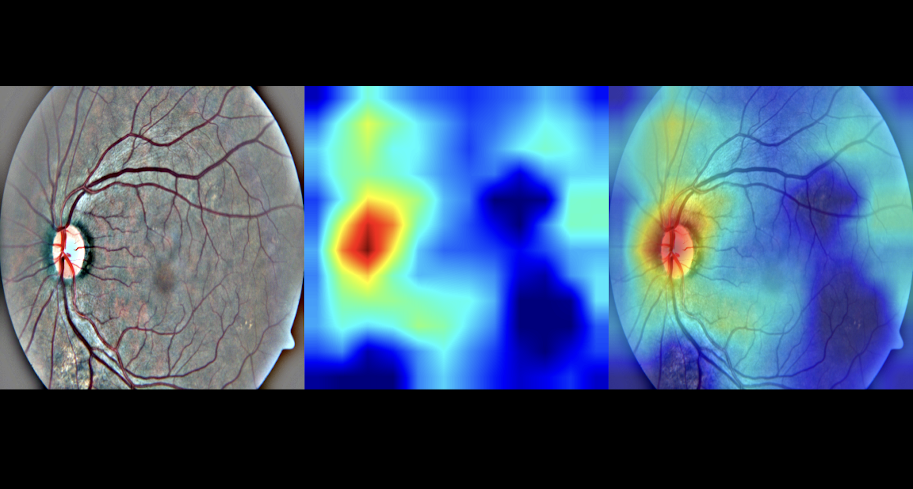

# Lumoculis

AI-assisted diabetic retinopathy screening support and research prototype.

Lumoculis classifies retinal fundus images into five diabetic retinopathy (DR) severity grades (0–4) using an EfficientNet-B0 model trained on APTOS 2019. It also flags referable DR (grade ≥ 2), provides heuristic image-quality assessment, optional Grad-CAM visualizations, probability calibration, and evaluation reporting.

**Research prototype only.** Lumoculis is not a medical device, is not clinically validated, and must not replace assessment by a qualified eye-care professional.

## Motivation

Diabetic retinopathy is a leading cause of preventable vision loss. Lumoculis explores whether a compact deep-learning model can support research workflows for retinal image grading, while exposing model behavior through explainability, quality checks, calibration, and reproducible evaluation.

## Key Features

- Five-class DR severity classification (grades 0–4).
- Referable DR flag for grades 2–4.
- Heuristic image-quality checks: resolution, exposure, blur, and retinal field of view.
- Optional cloud-hosted Grad-CAM visualizations (Modal + PyTorch).
- Browser-side JPEG compression for Grad-CAM uploads.
- Server-side Vercel proxy with Upstash Redis rate limiting (10 requests per IP per minute when configured).
- Temperature-scaled probability calibration.
- FastAPI backend with JSON prediction reports.
- Next.js frontend and legacy Streamlit interface.
- Experiment comparison reports (baseline and Experiments A–E).
- Duplicate-aware data splitting and holdout evaluation tooling.
- Pytest test suite and Ruff linting.

## Screenshots







## Production Architecture

**Prediction flow:** Browser → Vercel Next.js frontend → Render FastAPI/ONNX prediction API → prediction response.

**Optional Grad-CAM flow:** Browser → Vercel `/api/gradcam` proxy → Upstash Redis rate limiter → authenticated Modal Grad-CAM service → private S3 PyTorch checkpoint → PNG visualization.

The browser compresses a copy of the uploaded image for Grad-CAM to fit within Vercel's request-body limit; the original image is retained for prediction. Grad-CAM is optional, and a visualization failure does not invalidate a successful prediction.

The Python package under `src/lumoculis/` contains model loading, preprocessing, inference, quality assessment, calibration, metrics, and data splitting. The Next.js frontend is in `frontend/`; the Modal service is in `deploy/modal/gradcam.py`. A Streamlit application in `app.py` remains available.

See [Architecture](docs/architecture.md) and [Production Deployment](docs/deployment.md).

## Technology Stack

| Area | Technologies |
|---|---|
| Language | Python 3.11+, TypeScript |
| ML framework | PyTorch, torchvision, timm |
| Model | EfficientNet-B0 |
| Backend | FastAPI, Pydantic, Uvicorn |
| Frontend | Next.js, React, Tailwind CSS |
| Image processing | OpenCV, NumPy, Pillow |
| Metrics | scikit-learn |
| Experiment tracking | MLflow |
| Legacy UI | Streamlit |
| Testing | pytest, Ruff |
| Dependency management | uv |

## Dataset

Lumoculis uses the **APTOS 2019** diabetic retinopathy dataset. The dataset provides retinal fundus images labeled with five DR severity grades.

Dataset access and use must follow the applicable dataset license and terms. The repository does not include the full dataset.

## DR Classification Grades

| Grade | Description |
|---:|---|
| 0 | No diabetic retinopathy |
| 1 | Mild non-proliferative diabetic retinopathy |
| 2 | Moderate non-proliferative diabetic retinopathy |
| 3 | Severe non-proliferative diabetic retinopathy |
| 4 | Proliferative diabetic retinopathy |

Referable DR is defined in this project as grade ≥ 2.

## Model Architecture

- Backbone: EfficientNet-B0
- Framework: PyTorch
- Output classes: 5
- Input size: 384 × 384
- Pretrained initialization is used during training
- Checkpoint selection is based on validation quadratic weighted kappa (QWK)

## Evaluation Methodology and Verified Metrics

All experiments use the same 730-image validation set derived from `train_val_split()`.

| Metric | Baseline | A | B | C | D | E |
|---|---:|---:|---:|---:|---:|---:|
| QWK | 0.85218 | 0.74057 | 0.75342 | 0.83767 | 0.87326 | 0.87564 |
| Accuracy | 0.81100 | 0.63425 | 0.68493 | 0.77534 | 0.80411 | 0.80000 |
| MAE | 0.26000 | 0.53425 | 0.52329 | 0.34384 | 0.26301 | 0.26712 |
| Balanced accuracy | 0.55020 | 0.54588 | 0.47745 | 0.65251 | 0.62953 | 0.69845 |
| Macro F1 | 0.54940 | 0.44693 | 0.42804 | 0.62795 | 0.63369 | 0.67084 |
| Referable DR AUROC | 0.97600 | 0.93145 | 0.93940 | 0.97899 | 0.98055 | 0.97976 |
| Grade 3 recall | 0.00000 | 0.50000 | 0.00000 | 0.47368 | 0.26316 | 0.60526 |

Experiment E is the current leading candidate when prioritizing QWK, balanced accuracy, macro F1, and Grade 3 recall together. These are validation-set research metrics, not clinical accuracy claims.

An exploratory holdout evaluation using Experiment C produced:

| Metric | Value |
|---|---:|
| QWK | 0.9058 |
| Accuracy | 84.95% |
| MAE | 0.2153 |
| Balanced accuracy | 78.93% |
| Macro F1 | 75.27% |
| Referable DR AUROC | 0.9886 |
| Referable sensitivity | 92.61% |
| Referable specificity | 96.88% |
| Test samples | 432 |

This holdout evaluation is exploratory because the original training IDs were not saved, so overlap between the checkpoint's training data and the holdout test set cannot be ruled out.

## Image Quality Assessment

The quality gate performs heuristic checks on uploaded images:

- Resolution
- Underexposure
- Overexposure
- Blur, using Laplacian variance on a standardized retinal field-of-view crop
- Retinal field-of-view content fraction

Quality thresholds are configurable and are not clinically validated.

## Grad-CAM Explainability

Grad-CAM can be generated on request to highlight image regions that influenced the model's prediction. Grad-CAM does not establish disease location or causality.

## Backend API Endpoints

Base URL: `http://localhost:8000`

| Method | Endpoint | Description |
|---|---|---|
| GET | `/health` | Backend and model status |
| GET | `/model-info` | Checkpoint metadata and configuration |
| POST | `/predict` | Image upload and prediction |
| GET | `/gradcam/{filename}` | Grad-CAM image retrieval |

`POST /predict` accepts multipart form data with a `file` field and optional fields:

- `run_quality_gate`
- `quality_required`
- `gradcam`
- `device`

The response includes predicted grade, referable status, raw and calibrated probabilities, quality result, optional Grad-CAM URL, image dimensions, and the research disclaimer.

## Project Directory Structure

```text
Lumoculis/
├── app.py                         # Streamlit application
├── src/lumoculis/                 # Python ML package
│   ├── api/main.py                # FastAPI backend
│   ├── inference.py               # Inference and calibration
│   ├── model.py                   # Model construction
│   ├── preprocess.py              # Image preprocessing
│   ├── quality.py                 # Quality assessment
│   ├── explain.py                 # Grad-CAM
│   ├── metrics.py                 # Evaluation metrics
│   ├── data.py                    # Dataset splitting
│   └── train.py                   # Training pipeline
├── frontend/                      # Next.js frontend
├── configs/                       # Experiment YAML configs
├── scripts/                       # Utility and evaluation scripts
├── tests/                         # Pytest tests
├── reports/                       # Generated evaluation reports
├── checkpoints/                   # Model checkpoints (not committed)
├── data/                          # Dataset and processed images (not committed)
├── Dockerfile
├── MODEL_CARD.md
└── pyproject.toml
```

## Installation Requirements

- Python 3.11+
- `uv`
- Node.js and npm
- PyTorch-compatible environment
- APTOS 2019 data placed under `data/raw/` and processed images under `data/processed/`
- A trained checkpoint, or training from a provided config

## Backend Setup

```bash
cd Lumoculis
uv sync --dev
```

Run the FastAPI backend:

```bash
LUMOCULIS_CHECKPOINT=checkpoints/expC_weighted_sampling_20261101_172044/best.pt \
uv run uvicorn src.lumoculis.api.main:app --reload --port 8000
```

Optional backend environment variables:

- `LUMOCULIS_CALIBRATION`
- `LUMOCULIS_DEVICE` (`cpu`, `mps`, or `auto`)
- `LUMOCULIS_MAX_UPLOAD_MB`
- `LUMOCULIS_CORS_ORIGINS`

Run the Streamlit application:

```bash
uv run streamlit run app.py
```

Train a model:

```bash
uv run python -m lumoculis.train --config configs/experiment_e_sampling_medium_loss_weights.yaml
```

## Frontend Setup

```bash
cd Lumoculis/frontend
npm install
npm run dev
```

Set `NEXT_PUBLIC_API_URL` to the local FastAPI base URL (normally `http://localhost:8000`). For local Grad-CAM, also configure the server-side Modal URL and token. Upstash credentials are required to activate rate limiting. See [Production Deployment](docs/deployment.md); do not commit `.env.local`.

## Environment Variables

Backend:

- `LUMOCULIS_CHECKPOINT`: path to the model checkpoint
- `LUMOCULIS_CALIBRATION`: optional temperature-scaling JSON path
- `LUMOCULIS_DEVICE`: `cpu`, `mps`, or `auto`
- `LUMOCULIS_MAX_UPLOAD_MB`: maximum upload size
- `LUMOCULIS_CORS_ORIGINS`: comma-separated allowed frontend origins

Frontend:

- `NEXT_PUBLIC_API_URL`: Render prediction API URL
- `MODAL_GRADCAM_URL`: Modal `/gradcam` endpoint (server-side only)
- `MODAL_GRADCAM_TOKEN`: Modal bearer token (server-side only)
- `UPSTASH_REDIS_REST_URL` and `UPSTASH_REDIS_REST_TOKEN`: activate distributed rate limiting (server-side only)

Never add secret values to source control. See [Production Deployment](docs/deployment.md) for full configuration.

## Usage

1. Start the FastAPI backend.
2. Start the Next.js frontend.
3. Open `http://localhost:3000`.
4. Navigate to **Analyze Image**.
5. Upload a PNG or JPEG retinal fundus image (maximum 10 MB).
6. Optionally enable image-quality assessment and Grad-CAM.
7. Run analysis and review the predicted grade, probabilities, quality result, and Grad-CAM.
8. Download the JSON prediction report.

## Limitations and Responsible AI Disclaimer

Lumoculis is an experimental research prototype. It is not a medical device, is not clinically validated, and must not replace assessment by a qualified eye-care professional.

Additional limitations:

- APTOS 2019 does not provide patient IDs, so patient-level independence between training and validation data cannot be guaranteed.
- Exact-duplicate grouping cannot detect all near-duplicates.
- Image-quality thresholds are heuristic and have not been clinically validated.
- Grad-CAM highlights model-relevant regions; it does not establish disease location or causality.
- Probability calibration does not establish clinical reliability.
- Reported metrics are validation or exploratory holdout metrics, not clinical accuracy claims.
- Multiple experiments were compared on the same validation set.

## Future Improvements

- Evaluate the selected checkpoint on a genuinely independent test set.
- Investigate Grade 2 and Grade 3 misclassifications.
- Add external validation on datasets such as IDRiD or Messidor-2.
- Improve handling of class imbalance.
- Repeat experiments with multiple random seeds.
- Expand image-quality calibration for different acquisition devices.

## License

This project is released under the MIT License. See [`LICENSE`](LICENSE) for details.

The MIT License applies to the Lumoculis code. It does not grant rights to redistribute the APTOS 2019 dataset or other third-party assets, which remain subject to their own terms.
EOF
echo "written"